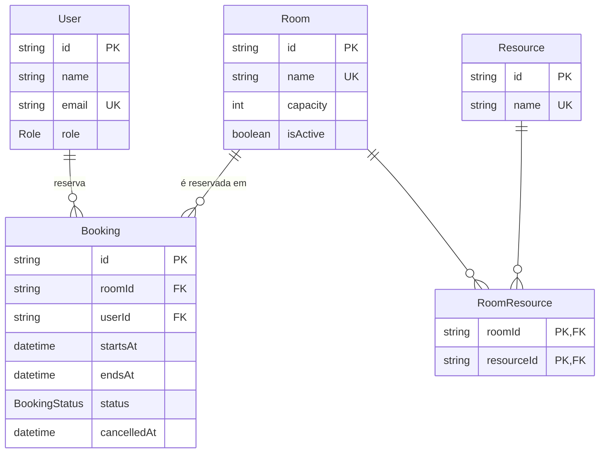

# Reserva de Salas

Sistema de reserva de salas de reunião, desenvolvido como desafio técnico **Full Stack Pleno — Sensedia**.

Usuários escolhem uma sala, data e horário e fazem a reserva. As regras de negócio (sem sobreposição, sem horário no passado, limites de duração) são validadas no servidor. Administradores cadastram e editam salas.

> 🚧 Em desenvolvimento. Este README é atualizado a cada card. Itens marcados como _(planejado)_ ainda não foram implementados.

## Como rodar

Pré-requisito: **Node.js 24** (npm incluso).

```bash
npm install
npm run db:setup   # aplica as migrations, gera o Prisma Client e popula o banco
npm run dev        # http://localhost:3000
```

Não é preciso criar `.env`: sem `DATABASE_URL`, o projeto usa o SQLite local `./dev.db`. Para sobrescrever, copie `.env.example` para `.env`.

O seed é idempotente, então `npm run db:setup` pode ser executado de novo sem duplicar dados.

### Verificações

```bash
npm test            # testes (Vitest)
npm run typecheck   # TypeScript em modo strict
npm run lint        # ESLint
```

O CI ([`.github/workflows/ci.yml`](.github/workflows/ci.yml)) roda essas mesmas verificações, mais o `next build`, em todo PR e push para `main` e `develop`.

Os testes ficam ao lado do código que testam (`arquivo.ts` + `arquivo.test.ts`). O Next.js não impõe um local para testes, e assim cada regra de negócio fica junto do seu teste, inclusive na leitura dos PRs.

### Dados do seed

| Usuário | E-mail | Papel |
|---|---|---|
| Ana Souza | ana@example.com | Usuário comum |
| Bruno Lima | bruno@example.com | Usuário comum |
| Carla Mendes | carla@example.com | Administradora |

São 7 salas (6 ativas e 1 desativada), com capacidades de 4 a 20 pessoas e combinações dos recursos Projetor, TV, Videoconferência e Quadro branco. A variedade existe para exercitar os filtros por capacidade e por recurso.

Há também 3 reservas de exemplo no próximo dia útil (09h–12h), para a demo sempre mostrar reservas futuras.

Para entrar, acesse `/entrar` e escolha um usuário ("Entrar como").

## Stack

| Camada | Escolha | Por quê |
|---|---|---|
| Framework | Next.js 16 (App Router) + TypeScript `strict` | Requisito do desafio. Front e back no mesmo projeto. |
| Banco | SQLite | Relacional, sem servidor para instalar. Quem avalia roda o projeto em 3 comandos. |
| ORM / migrations | Prisma 7 | Schema declarativo, migrations versionadas e client tipado. |
| Mutations | Server Actions | Mutação chamada direto do formulário, executada e validada no servidor, sem API REST à parte. |
| UI | Tailwind CSS + shadcn/ui (Base UI) | Componentes acessíveis, copiados para o projeto em `src/components/ui` (sem dependência de lib de UI fechada). |
| Validação | Zod | Converte e valida entradas não confiáveis (URL e formulários) com tipagem. |
| Testes | Vitest | Rápido, com suporte nativo a TypeScript e sem configuração de transpilação. |

## Decisões

### Modelo de dados



- **Recursos como tabela N:N (`Resource` + `RoomResource`)**, em vez de texto ou JSON na sala. O filtro "salas com projetor" vira uma consulta relacional simples, e a lista de recursos fica normalizada.
- **Cancelar reserva muda o status (`ACTIVE` → `CANCELLED`)** e preenche `cancelledAt`, sem apagar a linha. A reserva cancelada deixa de bloquear o horário, mas o histórico continua consultável.
- **Salas são desativadas (`isActive`), não apagadas.** As chaves estrangeiras de `Booking` usam `ON DELETE RESTRICT`, então apagar uma sala com reservas quebraria o histórico. Desativar mantém a integridade e tira a sala da listagem.
- **Datas em UTC no banco; regras de horário no fuso fixo `America/Sao_Paulo`.** Assim o comportamento não depende do fuso do servidor nem do navegador.
- **A duração máxima por sala não está no schema inicial.** O campo entra numa migration própria no card SALA-6, que substitui o limite fixo de 4 h. Assim o histórico de migrations acompanha a evolução dos requisitos.

### Listagem e filtros (SALA-1)

- **Filtros na URL:** `/salas?capacidade=8&recurso=Projetor&recurso=TV`. O link pode ser compartilhado e reflete exatamente o que está na tela.
- **Capacidade é "pelo menos N pessoas"** (`capacidade ≥ N`): quem procura sala para 8 aceita uma de 10.
- **Vários recursos = a sala precisa ter todos.** Quem pede projetor e videoconferência precisa dos dois.
- **Salas desativadas não aparecem** na listagem.
- **Formulário GET com o `<Form>` do Next.** Ao enviar, os campos viram parâmetros da URL, e a página lê os filtros no servidor. Não há estado de filtro no cliente, e o formulário funciona até sem JavaScript.
- **Valores inválidos na URL são ignorados** (ex.: `?capacidade=abc`), em vez de quebrar a página, já que qualquer pessoa pode editar o link. A leitura dos filtros é uma função pura testada ([`filters.ts`](src/features/rooms/filters.ts)).
- **Cache Components (Next 16):** o título da página é pré-renderizado, e a lista, que depende da URL e do banco, é renderizada a cada requisição dentro de um `<Suspense>`. Não há cache de dados, para a listagem refletir na hora as edições do admin.
- **Código organizado por funcionalidade** (`src/features/rooms`: filtros, consultas e componentes). `src/app` fica só com as rotas, seguindo a estratégia "store project files outside of `app`" da documentação do Next.
- **Consultas numa Data Access Layer** ([`queries.ts`](src/features/rooms/queries.ts)), padrão recomendado pelo guia de segurança de dados do Next. É o único ponto de acesso ao banco para salas, devolve objetos enxutos (não a linha inteira do banco) e é o lugar onde ficam as checagens de permissão nos próximos cards. O arquivo é marcado com `import "server-only"`: se for importado por um componente de navegador, o build falha. O `db.ts` não leva essa marcação porque o seed também o usa, fora do Next.

### Login fake e permissões

- **"Entrar como"** em `/entrar`: o usuário escolhe alguém do seed, e o servidor grava **só o ID** num cookie `httpOnly`. A Server Action recusa IDs que não existem no banco.
- **O servidor decide tudo.** [`getCurrentUser`](src/features/auth/session.ts) lê o cookie e carrega o usuário do banco a cada requisição. Quem faz a reserva vem sempre do cookie, nunca de um campo do formulário. Cada Server Action confere o usuário de novo, como recomenda o guia de autenticação do Next.
- **Limitação assumida:** o cookie não é assinado, então quem editar o cookie à mão "vira" outro usuário. É o esperado de um login fake, que o desafio dispensa. Num login real, a sessão seria assinada ou criptografada (ou viria de um provedor de identidade).

### Reservas (SALA-2)

- **Fluxo:** cada card de sala tem "Reservar", que leva a `/salas/[id]`, com o formulário (data, início, fim) e a lista das próximas reservas da sala, para ver os horários ocupados antes de enviar.
- **Regras como funções puras** em [`rules.ts`](src/features/bookings/rules.ts): fim depois do início, sem passado, duração de 15 min a 4 h, sem sobreposição. Elas recebem "agora" e as reservas existentes como parâmetro, sem acessar banco nem relógio, por isso são testáveis isoladamente. Os cards SALA-5 (horário útil) e SALA-6 (duração por sala) vão mexer neste mesmo módulo.
- **Fuso horário:** o horário digitado é de Brasília, convertido para UTC num único ponto ([`time.ts`](src/features/bookings/time.ts)) com deslocamento fixo de **-03:00**. O Brasil não tem horário de verão desde 2019, e isso evita uma biblioteca de fuso. Se o horário de verão voltar, a mudança fica nesse arquivo. A exibição usa `Intl` com `America/Sao_Paulo`. O "hoje" do formulário é calculado no servidor, então não depende do fuso do navegador.
- **Datas inexistentes são recusadas.** O JavaScript transforma 31/02 em 03/03 sem avisar. A conversão confere se a data continua a mesma que foi digitada, e a Server Action barra a data inválida antes de chegar ao banco. Esse bug foi pego por um teste.
- **Uma mensagem por vez:** a validação devolve a primeira regra violada, com uma mensagem clara em português.
- **Depois de reservar**, a página é atualizada (`refresh()`), mostra a confirmação e a nova reserva aparece na lista.

### Minhas reservas e cancelamento (SALA-3)

- **`/minhas-reservas`** (exige login) mostra **Próximas**, com o botão Cancelar, e **Histórico**, com as reservas passadas e canceladas. O histórico só existe porque cancelar muda o status em vez de apagar a linha.
- **Só o dono cancela**, inclusive o admin: o desafio diz "apenas as próprias", então não há exceção para admin. Só reservas **ativas que ainda não começaram** podem ser canceladas. Uma reserva em andamento aparece com a etiqueta "Em andamento".
- **Regra pura e testada:** [`canCancelBooking`](src/features/bookings/rules.ts) é usada em dois lugares: na Server Action, que decide, e na listagem, que só mostra o botão quando a regra permite. Uma regra só, sem divergência entre tela e servidor.
- **Defesa em profundidade:** a listagem sempre filtra pelo usuário logado, e mesmo que alguém forje um envio com o ID de uma reserva alheia, a Server Action relê o usuário do cookie e recusa. A resposta é "Reserva não encontrada", para não revelar que a reserva de outra pessoa existe. A tentativa fica registrada como `booking.cancel_denied`.
- **Confirmação nativa** do navegador ("Cancelar esta reserva?") antes de enviar, para evitar cancelamento por clique acidental.

### Admin de salas (SALA-4)

- **Páginas:** `/admin/salas` lista todas as salas (as desativadas aparecem marcadas), com cadastro em `/admin/salas/nova` e edição em `/admin/salas/[id]/editar`. O link "Admin" no cabeçalho só aparece para admin, mas esconder o link é só conforto visual: a proteção está no servidor.
- **"Nem pela URL":** cada página do admin chama [`requireAdmin()`](src/features/auth/session.ts). Sem login, vai para `/entrar`. Um usuário comum recebe **404**, para a área nem "existir" para ele. A checagem não fica só no layout, porque o guia de autenticação do Next avisa que layouts não protegem tudo.
- **A Server Action se protege sozinha.** `saveRoomAction` checa `isAdmin()` por conta própria, já que uma Server Action pode ser chamada diretamente, sem passar pela página. Testado forjando um envio do formulário de admin com o cookie de um usuário comum: recusado, nada criado.
- **Por que 404 e não 403:** o Next tem `forbidden()` (403), mas ele ainda é experimental nesta versão. O 404 é estável e não revela que a área existe.
- **Campos:** nome (único, de 2 a 60 caracteres), capacidade (de 1 a 100), recursos e ativa/desativada, validados com Zod no servidor ([`room-form.ts`](src/features/rooms/room-form.ts), com testes). Nome repetido retorna "Já existe uma sala com esse nome", em vez de um erro de banco.
- **Desativar, nunca apagar.** Ao desativar uma sala com reservas futuras, as reservas continuam valendo, mas a sala sai da listagem e não aceita novas reservas. Bloquear a desativação criaria um impasse, porque o admin não pode cancelar reservas de outras pessoas (SALA-3).

### Sobreposição de reservas

O SQLite não tem constraint de exclusão para intervalos (como o `EXCLUDE` do PostgreSQL). Por isso a regra de sobreposição fica no código: uma reserva conflita se, na mesma sala, existe outra **ativa** com `início < novo fim` **e** `fim > novo início`. Os intervalos são semiabertos, então uma reserva que termina às 10h **não** conflita com outra que começa às 10h.

A checagem e a inserção rodam na **mesma transação** ([`createBookingIfAvailable`](src/features/bookings/queries.ts)), para evitar que duas requisições simultâneas reservem o mesmo horário. O banco só filtra as reservas ativas da sala que ainda não terminaram, e a decisão de conflito fica na função pura testada.

### Observabilidade

- **Logs estruturados:** [`logger.ts`](src/lib/logger.ts) escreve uma linha JSON por evento na saída padrão, sem dependência nova. Em produção, cada campo vira filtrável no CloudWatch Logs.
- **Eventos de negócio:** `auth.signed_in`, `booking.created` e `booking.rejected`, com o motivo (`OVERLAP`, `IN_PAST`, `TOO_LONG`...), além de `booking.cancelled`, `booking.cancel_denied`, `room.created`, `room.updated` e `admin.access_denied`. Assim dá para medir quais regras mais barram reservas, e tentativas de cancelar reservas alheias (`NOT_OWNER`) ou de acessar o admin viram um sinal de segurança.
- **Limitação conhecida:** eventos registrados durante a renderização de uma página (como o `admin.access_denied` ao abrir `/admin`) podem aparecer duplicados, porque o Next pode renderizar a página mais de uma vez por requisição. Eventos de Server Actions (reservas, cancelamentos, cadastro de salas) são exatos, porque elas executam uma vez só.
- **Erros inesperados:** [`instrumentation.ts`](src/instrumentation.ts) usa o `onRequestError` do Next para registrar todo erro não tratado no servidor, no mesmo formato.
- **Privacidade:** só IDs e metadados. Nunca nome, e-mail ou headers da requisição (eles carregam cookies).

### Setup e ambiente

- **Setup em 3 comandos.** `DATABASE_URL` tem valor padrão em [`src/lib/database-url.ts`](src/lib/database-url.ts), compartilhado pelo Prisma CLI e pela aplicação. Assim o `.env` é opcional.
- **Seed idempotente** (upsert por campos únicos). As reservas de exemplo são calculadas a partir do dia em que o seed roda e validadas pelas mesmas regras da aplicação, então o seed não grava dados que o próprio sistema recusaria. Se uma delas conflitar com uma reserva já existente, ela é pulada com um aviso, sem quebrar o setup.
- **Versões fixadas.** No momento do setup, a tag `latest` do Prisma no npm apontava para uma release candidate (`8.0.0-rc`). Por isso o Prisma está fixado na `7.10.0` estável. As demais dependências novas também usam versão exata, de releases com pelo menos duas semanas. O `shadcn init` instala as versões mais recentes de tudo (algumas publicadas dois dias antes), então as dependências dele foram refixadas à mão, e o `shadcn` foi movido para `devDependencies`, já que só é usado no build.
- **`@types/node` alinhado ao Node 24.** O create-next-app gera `@types/node` 20, mas o projeto roda em Node 24, e o Vitest 5 exige tipos do Node 22 ou superior.
- **Scripts de instalação aprovados explicitamente** (`allowScripts` no `package.json`). Só `prisma`, `@prisma/engines` e `better-sqlite3` (binário nativo do SQLite) estão liberados.

## Fluxo de trabalho (Git flow)

- `main`: código em produção, com tags de versão.
- `develop`: integração.
- `feature/SALA-n-descricao`: um PR por card, para `develop`.
- `release/x.y.z` e `hotfix/...` seguem o Git flow clássico.

As branches `main` e `develop` são protegidas: merge só via PR, sem push direto (nem de administradores), sem force push e com o CI passando.

Os commits seguem o padrão [Conventional Commits](https://www.conventionalcommits.org/).

**SALA-0** é um card de setup criado por mim (não existe no enunciado). Ele cobre o passo 1 do Git flow (lint, testes e CI) e também o banco: schema, migration inicial e seed. O banco entra no setup porque o projeto precisa "subir com dados em até 3 comandos" antes de qualquer card, e porque os cards SALA-1 a SALA-4 dependem das mesmas tabelas. Assim cada PR de feature fica focado na funcionalidade.

## O que ficou de fora

_(a completar ao final do desafio)_

- **Mensagens do formulário de reserva sem JavaScript.** A reserva funciona sem JavaScript (é criada ou recusada corretamente), mas a mensagem de confirmação ou erro só aparece com JavaScript ligado.
- **Feriados no horário comercial (SALA-5).** A regra aceita reservas de segunda a sexta, das 08h às 20h, mas não conhece feriados, porque isso exigiria um calendário de feriados (nacionais e locais). Reservas já existentes fora do horário continuam valendo; a regra vale para reservas novas.

### Melhorias futuras

- **Histórico de auditoria.** Uma tabela `AuditLog` append-only registraria quem criou ou editou salas e quem criou ou cancelou reservas, com snapshots antes/depois em JSON, gravados na mesma transação da ação. Ela chegou a ser modelada, mas foi retirada do escopo: não é pedida no desafio, e o tempo foi priorizado para os requisitos obrigatórios. O cancelamento por status (sem apagar a linha) já preserva o histórico básico das reservas.

## Arquitetura na AWS

_(planejado)_
