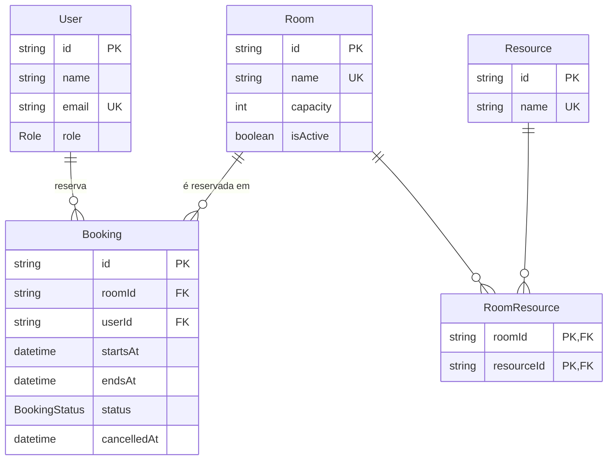

# Reserva de Salas

Sistema de reserva de salas de reunião, desenvolvido como desafio técnico **Full Stack Pleno — Sensedia**.

Usuários escolhem uma sala, data e horário e fazem a reserva. As regras de negócio (sem sobreposição, sem horário no passado, limites de duração) são validadas no servidor. Administradores cadastram e editam salas.

> 🚧 Em desenvolvimento. Este README é atualizado a cada card. Itens marcados como _(planejado)_ ainda não foram implementados.

## Como rodar

Pré-requisito: **Node.js 24** (npm incluso).

```bash
npm install
npm run db:setup   # aplica as migrations, gera o Prisma Client e popula o banco
npm run dev        # http://localhost:3000
```

Não é preciso criar `.env`: sem `DATABASE_URL`, o projeto usa o SQLite local `./dev.db`. Para sobrescrever, copie `.env.example` para `.env`.

O seed é idempotente, então `npm run db:setup` pode ser executado de novo sem duplicar dados.

### Verificações

```bash
npm test            # testes (Vitest)
npm run typecheck   # TypeScript em modo strict
npm run lint        # ESLint
```

O CI ([`.github/workflows/ci.yml`](.github/workflows/ci.yml)) roda essas mesmas verificações, mais o `next build`, em todo PR e push para `main` e `develop`.

Os testes ficam ao lado do código que testam (`arquivo.ts` + `arquivo.test.ts`). O Next.js não impõe um local para testes, e assim cada regra de negócio fica junto do seu teste, inclusive na leitura dos PRs.

### Dados do seed

| Usuário | E-mail | Papel |
|---|---|---|
| Ana Souza | ana@example.com | Usuário comum |
| Bruno Lima | bruno@example.com | Usuário comum |
| Carla Mendes | carla@example.com | Administradora |

São 7 salas (6 ativas e 1 desativada), com capacidades de 4 a 20 pessoas e combinações dos recursos Projetor, TV, Videoconferência e Quadro branco. A variedade existe para exercitar os filtros por capacidade e por recurso.

## Stack

| Camada | Escolha | Por quê |
|---|---|---|
| Framework | Next.js 16 (App Router) + TypeScript `strict` | Requisito do desafio. Front e back no mesmo projeto. |
| Banco | SQLite | Relacional, sem servidor para instalar. Quem avalia roda o projeto em 3 comandos. |
| ORM / migrations | Prisma 7 | Schema declarativo, migrations versionadas e client tipado. |
| Mutations | Server Actions + Zod _(planejado)_ | Validação no servidor com o mesmo schema usado para tipar a entrada. |
| UI | Tailwind CSS + shadcn/ui (Base UI) | Componentes acessíveis, copiados para o projeto em `src/components/ui` (sem dependência de lib de UI fechada). |
| Validação | Zod | Converte e valida entradas não confiáveis (URL e formulários) com tipagem. |
| Testes | Vitest | Rápido, com suporte nativo a TypeScript e sem configuração de transpilação. |

## Decisões

### Modelo de dados



- **Recursos como tabela N:N (`Resource` + `RoomResource`)**, em vez de texto ou JSON na sala. O filtro "salas com projetor" vira uma consulta relacional simples, e a lista de recursos fica normalizada.
- **Cancelar reserva muda o status (`ACTIVE` → `CANCELLED`)** e preenche `cancelledAt`, sem apagar a linha. A reserva cancelada deixa de bloquear o horário, mas o histórico continua consultável.
- **Salas são desativadas (`isActive`), não apagadas.** As chaves estrangeiras de `Booking` usam `ON DELETE RESTRICT`, então apagar uma sala com reservas quebraria o histórico. Desativar mantém a integridade e tira a sala da listagem.
- **Datas em UTC no banco; regras de horário no fuso fixo `America/Sao_Paulo`.** Assim o comportamento não depende do fuso do servidor nem do navegador.
- **A duração máxima por sala não está no schema inicial.** O campo entra numa migration própria no card SALA-6, que substitui o limite fixo de 4 h. Assim o histórico de migrations acompanha a evolução dos requisitos.

### Listagem e filtros (SALA-1)

- **Filtros na URL:** `/salas?capacidade=8&recurso=Projetor&recurso=TV`. O link pode ser compartilhado e reflete exatamente o que está na tela.
- **Capacidade é "pelo menos N pessoas"** (`capacidade ≥ N`): quem procura sala para 8 aceita uma de 10.
- **Vários recursos = a sala precisa ter todos.** Quem pede projetor e videoconferência precisa dos dois.
- **Salas desativadas não aparecem** na listagem.
- **Formulário GET com o `<Form>` do Next.** Ao enviar, os campos viram parâmetros da URL, e a página lê os filtros no servidor. Não há estado de filtro no cliente, e o formulário funciona até sem JavaScript.
- **Valores inválidos na URL são ignorados** (ex.: `?capacidade=abc`), em vez de quebrar a página, já que qualquer pessoa pode editar o link. A leitura dos filtros é uma função pura testada ([`filters.ts`](src/features/rooms/filters.ts)).
- **Cache Components (Next 16):** o título da página é pré-renderizado, e a lista, que depende da URL e do banco, é renderizada a cada requisição dentro de um `<Suspense>`. Não há cache de dados, para a listagem refletir na hora as edições do admin.
- **Código organizado por funcionalidade** (`src/features/rooms`: filtros, consultas e componentes). `src/app` fica só com as rotas, seguindo a estratégia "store project files outside of `app`" da documentação do Next.
- **Consultas numa Data Access Layer** ([`queries.ts`](src/features/rooms/queries.ts)), padrão recomendado pelo guia de segurança de dados do Next. É o único ponto de acesso ao banco para salas, devolve objetos enxutos (não a linha inteira do banco) e é o lugar onde ficam as checagens de permissão nos próximos cards. O arquivo é marcado com `import "server-only"`: se for importado por um componente de navegador, o build falha. O `db.ts` não leva essa marcação porque o seed também o usa, fora do Next.

### Sobreposição de reservas

O SQLite não tem constraint de exclusão para intervalos (como o `EXCLUDE` do PostgreSQL). Por isso a regra de sobreposição fica no código: uma reserva conflita se, na mesma sala, existe outra **ativa** com `início < novo fim` **e** `fim > novo início`. A checagem e a inserção rodam na **mesma transação**, para evitar que duas requisições simultâneas reservem o mesmo horário _(planejado no SALA-2)_. O índice `(roomId, startsAt)` atende essa consulta.

As regras de reserva ficam como **funções puras num único módulo de domínio** _(planejado)_. Isso facilita os testes unitários e deixa as regras de horário útil (SALA-5) e de duração por sala (SALA-6) lado a lado.

### Setup e ambiente

- **Setup em 3 comandos.** `DATABASE_URL` tem valor padrão em [`src/lib/database-url.ts`](src/lib/database-url.ts), compartilhado pelo Prisma CLI e pela aplicação. Assim o `.env` é opcional.
- **Seed idempotente** (upsert por campos únicos). As reservas de exemplo entram no SALA-2, validadas pelas mesmas regras de domínio da aplicação. Assim o seed não grava dados que o próprio sistema rejeitaria.
- **Versões fixadas.** No momento do setup, a tag `latest` do Prisma no npm apontava para uma release candidate (`8.0.0-rc`). Por isso o Prisma está fixado na `7.10.0` estável. As demais dependências novas também usam versão exata, de releases com pelo menos duas semanas. O `shadcn init` instala as versões mais recentes de tudo (algumas publicadas dois dias antes), então as dependências dele foram refixadas à mão, e o `shadcn` foi movido para `devDependencies`, já que só é usado no build.
- **`@types/node` alinhado ao Node 24.** O create-next-app gera `@types/node` 20, mas o projeto roda em Node 24, e o Vitest 5 exige tipos do Node 22 ou superior.
- **Scripts de instalação aprovados explicitamente** (`allowScripts` no `package.json`). Só `prisma`, `@prisma/engines` e `better-sqlite3` (binário nativo do SQLite) estão liberados.

## Fluxo de trabalho (Git flow)

- `main`: código em produção, com tags de versão.
- `develop`: integração.
- `feature/SALA-n-descricao`: um PR por card, para `develop`.
- `release/x.y.z` e `hotfix/...` seguem o Git flow clássico.

As branches `main` e `develop` são protegidas: merge só via PR, sem push direto (nem de administradores), sem force push e com o CI passando.

Os commits seguem o padrão [Conventional Commits](https://www.conventionalcommits.org/).

**SALA-0** é um card de setup criado por mim (não existe no enunciado). Ele cobre o passo 1 do Git flow (lint, testes e CI) e também o banco: schema, migration inicial e seed. O banco entra no setup porque o projeto precisa "subir com dados em até 3 comandos" antes de qualquer card, e porque os cards SALA-1 a SALA-4 dependem das mesmas tabelas. Assim cada PR de feature fica focado na funcionalidade.

## O que ficou de fora

_(a completar ao final do desafio)_

### Melhorias futuras

- **Histórico de auditoria.** Uma tabela `AuditLog` append-only registraria quem criou ou editou salas e quem criou ou cancelou reservas, com snapshots antes/depois em JSON, gravados na mesma transação da ação. Ela chegou a ser modelada, mas foi retirada do escopo: não é pedida no desafio, e o tempo foi priorizado para os requisitos obrigatórios. O cancelamento por status (sem apagar a linha) já preserva o histórico básico das reservas.

## Arquitetura na AWS

_(planejado)_
